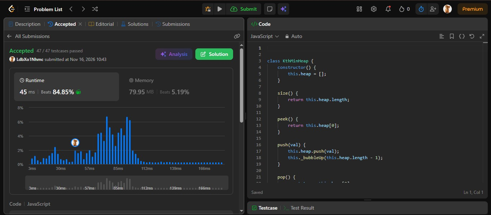
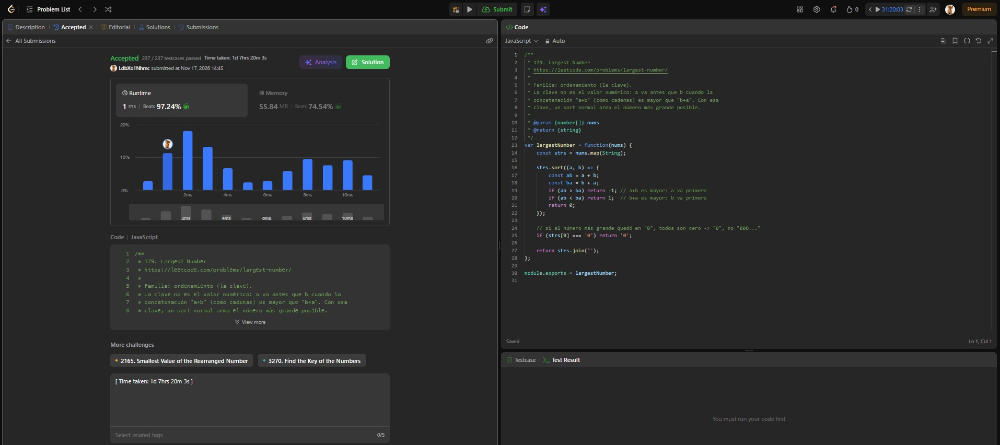
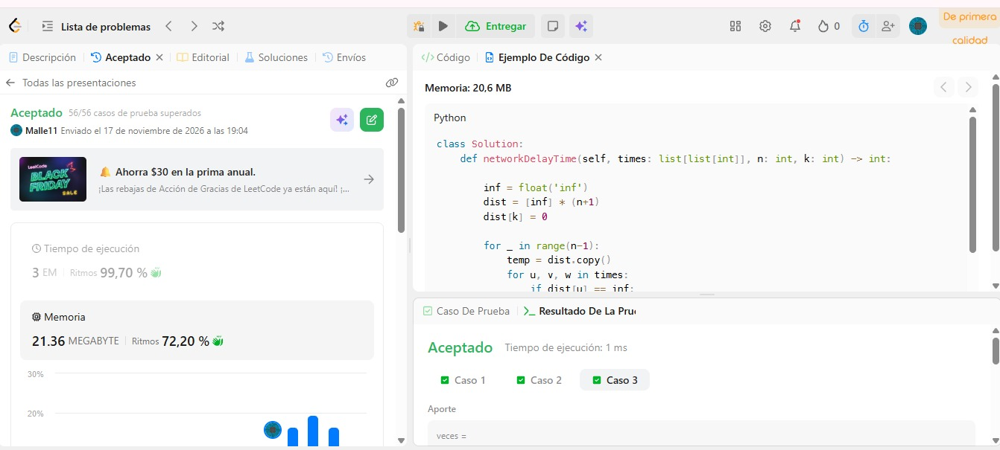
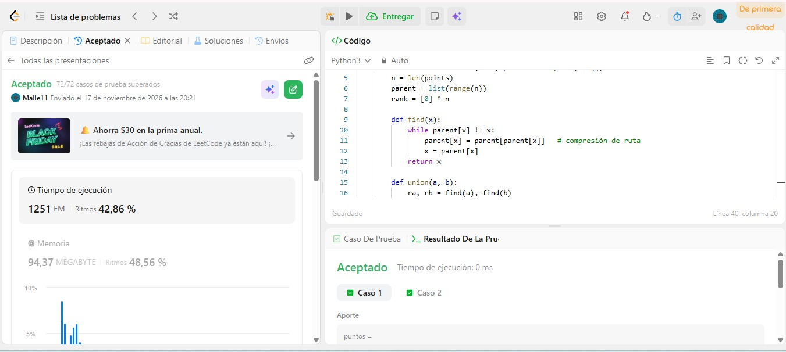
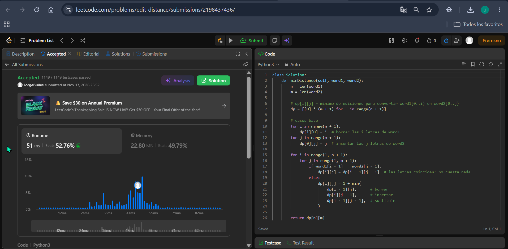
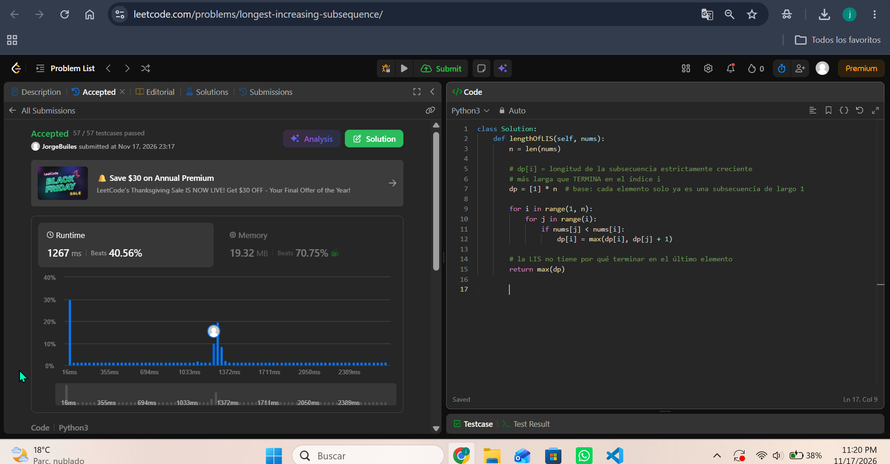
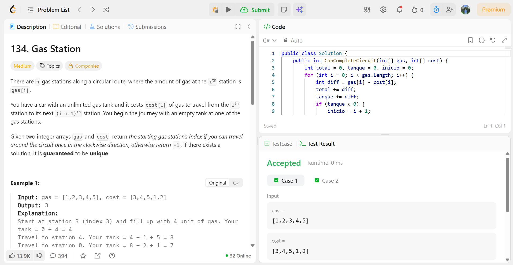
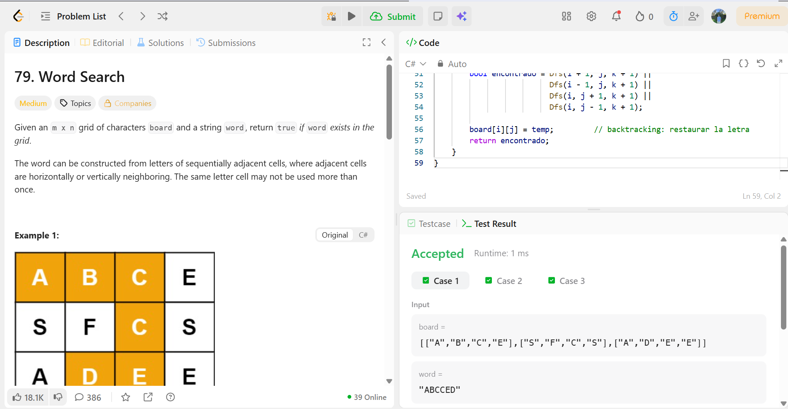

# Taller final — Análisis de algoritmos (ITM · 2026-2)

Ocho problemas Medium de LeetCode resueltos por el grupo, uno por familia
vista en el curso: heap, ordenamiento, grafos (Dijkstra y MST),
programación dinámica, greedy y backtracking.

> ⚠️ **Antes de entregar:** busca en este archivo todo lo que diga
> `PENDIENTE` y reemplázalo (nombres, usuarios de git y la elección de
> algoritmo de quien resolvió cada ejercicio). Borra este bloque al terminar.

## Autoría

| Integrante | Usuario de git | Ejercicios |
| --- | --- | --- |
| Luis Fernando Zapata Castaño  |  luisferzap12 | 215, 179 |
| Integrante 2: Luz Mallely Zapata | malle11 | 743, 1584 |
| Luz Mallely Zapata | malle11 | 743, 1584 |
| Jorge Elías Builes | JorgeBuiles | 72, 300 |
| PENDIENTE: integrante 4 | PENDIENTE | 134, 79 |

## Ejercicios

| # | Familia | Problema | Autor | Código | Evidencia |
| --- | --- | --- | --- | --- | --- |
| 1 | Heap | [215. Kth Largest Element in an Array](https://leetcode.com/problems/kth-largest-element-in-an-array/) | luisferzap12| [`kth-largest/`](./kth-largest/) | [jpg](./evidencias/kth-largest-accepted.jpg) |
| 2 | Ordenamiento (clave) | [179. Largest Number](https://leetcode.com/problems/largest-number/) | luisferzap12| [`largest-number/`](./largest-number/) | [jpg](./evidencias/largest-number-accepted.jpg) |
| 3 | Grafos (Dijkstra) | [743. Network Delay Time](https://leetcode.com/problems/network-delay-time/) | malle11 | [`network-delay-time/`](./network-delay-time/) | [png](./evidencias/network-delay-time-accepted.png) |
| 3 | Grafos (Dijkstra) | [743. Network Delay Time](https://leetcode.com/problems/network-delay-time/) | malle11| [`network-delay-time/`](./network-delay-time/) | [png](./evidencias/network-delay-time-accepted.png) |
| 4 | Grafos (MST) | [1584. Min Cost to Connect All Points](https://leetcode.com/problems/min-cost-to-connect-all-points/) | malle11 | [`min-cost-to-connect-all-points/`](./min-cost-to-connect-all-points/) | [png](./evidencias/min-cost-to-connect-all-points-accepted.png) |
| 5 | Programación dinámica | [72. Edit Distance](https://leetcode.com/problems/edit-distance/) | JorgeBuiles | [`edit-distance/`](./edit-distance/) | [png](./evidencias/edit-distance-accepted.png) |
| 6 | Programación dinámica | [300. Longest Increasing Subsequence](https://leetcode.com/problems/longest-increasing-subsequence/) | JorgeBuiles | [`longest-increasing-subsequence/`](./longest-increasing-subsequence/) | [png](./evidencias/longest-increasing-subsequence-accepted.png) |
| 7 | Greedy | [134. Gas Station](https://leetcode.com/problems/gas-station/) | PENDIENTE | [`gas-station/`](./gas-station/) | [png](./evidencias/gas-station-accepted.png) |
| 8 | Backtracking | [79. Word Search](https://leetcode.com/problems/word-search/) | PENDIENTE | [`word-search/`](./word-search/) | [png](./evidencias/word-search-accepted.png) |

---

## 215. Kth Largest Element in an Array

Autor: Luis Fernando Zapata Castaño: nombre (`luisferzap12`)  
Familia: heap  
Código: [`kth-largest/kth-largest.js`](./kth-largest/kth-largest.js)

No hace falta ordenar todo el arreglo. Se mantiene un **min-heap
de tamaño a lo sumo `k`** con los `k` mayores vistos hasta el momento. Si
el heap ya tiene `k` elementos y llega un valor mayor que la raíz, se saca
la raíz (el menor de los `k` candidatos) y entra el nuevo; si no, el valor
se descarta porque no puede estar entre los `k` mayores. Al terminar, la
raíz es el k-ésimo mayor. El heap está implementado a mano
(`push` / `pop` con `bubbleUp` / `bubbleDown`).

Complejidad (`n = nums.length`):
- Tiempo: `O(n log k)` — cada elemento hace a lo sumo una inserción y una
  extracción sobre un heap de tamaño `k`.
- Espacio: `O(k)` extra.

---

## 179. Largest Number

Autor: Luis Fernando Zapata Castaño: nombre (`luisferzap12`)  
Familia: ordenamiento (la clave)  
Código: [`largest-number/largest-number.js`](./largest-number/largest-number.js)

 la clave no es el valor numérico. Se pasan los números a
cadena y se ordenan con un comparador de concatenación: `a` va antes que
`b` cuando `a + b` es mayor que `b + a` (comparando cadenas). Así
`[10, 2]` queda `"2"`, `"10"` → `"210"` y no `"102"`. Después se unen las
cadenas. Caso borde: si el primero queda en `"0"`, todos eran cero y la
respuesta es `"0"`, no `"00…"`.

Complejidad (`n = nums.length`, `L` = máximo de dígitos por número):
- Tiempo: `O(n log n)` comparaciones, cada una lineal en la longitud de las
  cadenas (`O(L)`), es decir `O(n · L · log n)`.
- Espacio: `O(n)` para las cadenas y la salida.

---

## 743. Network Delay Time

Autor: Luz Mallely Zapata (`malle11`)  
Autor: PENDIENTE: Luz Mallely Zapata (`malle11`)  
Familia: grafos (Dijkstra)  
Código: [`network-delay-time/network-delay-time.js`](./network-delay-time/network-delay-time.js)

**Modelo:** grafo **dirigido y ponderado**. Vértices: los `n` nodos; arco
`u → v` con peso `w` (tiempo de la señal).

**Idea:** Dijkstra desde el nodo `k` con un heap de distancia tentativa: en
cada paso se extrae el nodo con **menor tiempo acumulado** y se relajan sus
arcos de salida. La respuesta es la **mayor** de las distancias finitas
(hay que esperar al nodo que más tarda); si algún nodo quedó en infinito,
`-1`. BFS por número de arcos no sirve porque los pesos no son iguales.

**Complejidad** (`n` nodos, `m = times.length`):
- Tiempo: `O((n + m) log n)` con heap.
- Espacio: `O(n + m)` (lista de adyacencia, distancias y heap).

---

## 1584. Min Cost to Connect All Points

Autor: Luz Mallely Zapata (`malle11`)  
Autor: PENDIENTE: Luz Mallely Zapata (`malle11`)  
Familia: grafos (árbol de recubrimiento mínimo)  
Código: [`min-cost-to-connect-all-points/min-cost-to-connect-all-points.js`](./min-cost-to-connect-all-points/min-cost-to-connect-all-points.js)

**Algoritmo usado:** Kruskal con Union-Find (compresión de ruta y unión por
rango).

**Modelo:** grafo completo no dirigido. Vértices: los puntos; arista entre
cada pareja con peso = distancia de Manhattan `|x₁ − x₂| + |y₁ − y₂|`.

**Idea (Kruskal):** se generan todas las aristas, se ordenan por peso y se
recorren de menor a mayor; una arista se acepta con `union` solo si sus
extremos están en componentes distintas (Union-Find), y se rechaza si
cerraría un ciclo. Se para al aceptar `n − 1` aristas. No hay origen: se
minimiza la **suma de las aristas del árbol** que conecta a todos.

**Complejidad** (`n = points.length`, hay `Θ(n²)` aristas):
- Kruskal: tiempo `O(n² log n)` (domina el sort de las aristas), espacio `O(n²)`.

---

## 72. Edit Distance

Autor: Jorge Elías Builes (`JorgeBuiles`)  
Familia: programación dinámica  
Código: [`edit-distance/`](./edit-distance/)

**Estado:** `dp[i][j]` = mínimo de ediciones para convertir `word1[0..i)` en
`word2[0..j)`.

**Casos base:** `dp[i][0] = i` (borrar `i` letras) y `dp[0][j] = j`
(insertar `j` letras).

**Recurrencia:**
- si `word1[i−1] == word2[j−1]`: `dp[i][j] = dp[i−1][j−1]`;
- si no: `dp[i][j] = 1 + min(dp[i−1][j], dp[i][j−1], dp[i−1][j−1])`
  (borrar, insertar, sustituir).

La respuesta es `dp[n][m]`. Es la tabla de Wagner–Fischer; un greedy de
«cambiar la primera letra que no coincide» no mira el resto de la cadena.

**Complejidad** (`n = word1.length`, `m = word2.length`):
- Tiempo: `Θ(n · m)`.
- Espacio: `Θ(n · m)` con la tabla completa (`Θ(min(n, m))` si se comprime a dos filas).

---

## 300. Longest Increasing Subsequence

Autor: Jorge Elías Builes (`JorgeBuiles`)   
Familia: programación dinámica  
Código: [`longest-increasing-subsequence/`](./longest-increasing-subsequence/)

**Estado:** `dp[i]` = longitud de la subsecuencia estrictamente creciente
más larga que **termina** en el índice `i`.

**Caso base:** `dp[i] = 1` (el elemento solo).

**Recurrencia:** `dp[i] = max(dp[i], 1 + dp[j])` para todo `j < i` con
`nums[j] < nums[i]`. La respuesta es el **máximo** de la tabla (la LIS más
larga puede no terminar en el último elemento). Ordenar el arreglo no
sirve: destruye qué índices se pueden usar.

**Complejidad** (`n = nums.length`):
- Tiempo: `Θ(n²)`.
- Espacio: `Θ(n)`.

---

## 134. Gas Station

Autor: PENDIENTE: nombre (`usuario-git`)  
Familia: greedy  
Código: [`gas-station/`](./gas-station/)

**Criterio local:** un acumulado que no se retracta. Si `sum(gas) < sum(cost)`
es imposible (`-1`); si no, existe exactamente un inicio. Se recorre una
sola vez sumando `gas[i] − cost[i]` a un tanque; cuando el tanque queda
negativo en `i`, se **descarta todo el tramo** desde el inicio candidato
hasta `i`, el candidato pasa a `i + 1` y el tanque vuelve a 0.

**Por qué no se vuelve atrás:** si desde el inicio `s` no se llega a
`i + 1`, cualquier estación `k` entre `s` e `i` se alcanzó con tanque `≥ 0`
desde `s`; empezar en `k` con tanque vacío es igual o peor, así que ninguna
sirve de inicio.

**Complejidad** (`n = gas.length`):
- Tiempo: `Θ(n)` (una pasada).
- Espacio: `Θ(1)` extra.

---

## 79. Word Search

Autor: PENDIENTE: nombre (`usuario-git`)  
Familia: backtracking  
Código: [`word-search/`](./word-search/)

**Qué se elige:** desde cada celda que coincide con la primera letra se
lanza la búsqueda; el estado es (posición en la grilla, índice de la letra
que toca en `word`). En cada paso se elige un vecino **ortogonal** (no
diagonal) que coincida con la letra siguiente y se **marca** como usado.

**Qué se deshace:** si la rama no completa la palabra, al regresar se
**quita la marca** de la celda y se prueba otro vecino. Una celda ya
usada en el camino actual no se pisa otra vez.

**Complejidad** (grilla `m × n`, palabra de longitud `L`):
- Tiempo: `O(m · n · 4^L)` en el peor caso (cada paso ramifica en hasta 4 vecinos).
- Espacio: `O(L)` de pila de recursión (la marca se hace sobre la misma grilla).

---

## Evidencias

Cada captura es el Submit → Accepted de LeetCode (tests en Passed),
con el título del problema, runtime/memoria y el usuario de LeetCode de
quien commiteó el código**. Viven en [`evidencias/`](./evidencias/).
